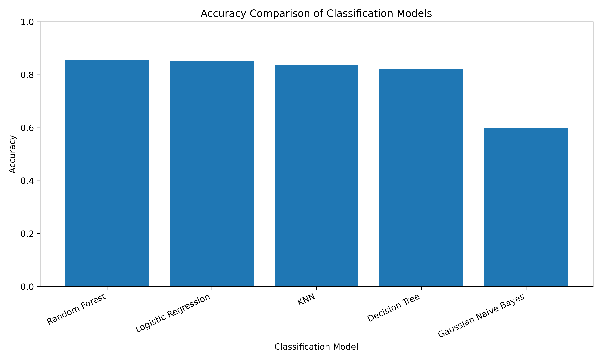
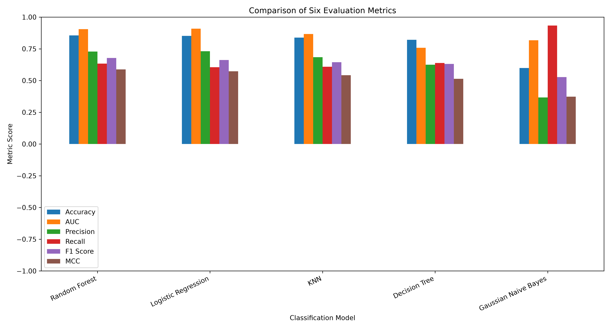
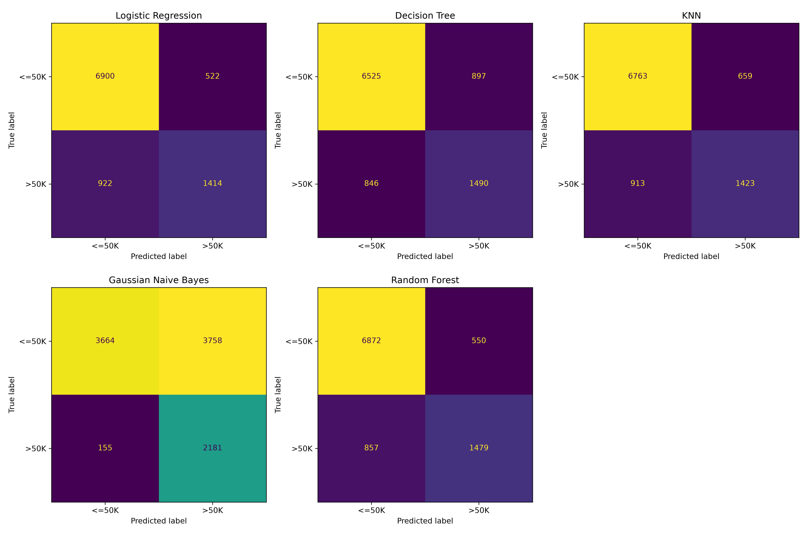
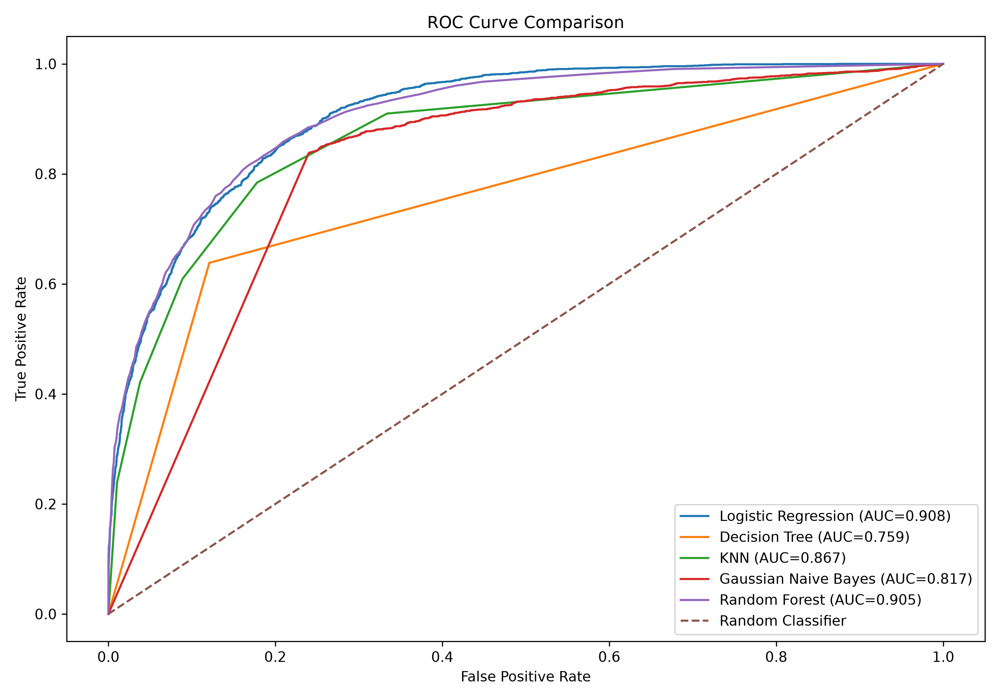

# Adult Census Income Classification

## 1. Problem Statement

The objective of this project is to develop and compare five
machine learning classification algorithms to predict whether
an individual's annual income is greater than $50K based on
demographic and employment-related attributes.

The classification task is a binary classification problem.

Target classes:
- 0: Income <=50K
- 1: Income >50K

The five algorithms implemented are:
1. Logistic Regression
2. Decision Tree
3. K-Nearest Neighbors
4. Gaussian Naive Bayes
5. Random Forest

## 2. Dataset Description

Dataset: Adult Census Income Dataset

Source:
https://archive.ics.uci.edu/dataset/2/adult

The dataset contains demographic and employment-related
attributes used to predict an individual's income category.

Original dataset:
- Records: 48,842
- Input features: 14
- Target variable: income
- Classification type: Binary classification

Numerical features:
- age
- fnlwgt
- education-num
- capital-gain
- capital-loss
- hours-per-week

Categorical features:
- workclass
- education
- marital-status
- occupation
- relationship
- race
- sex
- native-country

## 3. Data Cleaning and Preprocessing

The following steps were performed:

1. Loaded the Adult Census Income dataset.
2. Identified missing values represented by '?'.
3. Removed duplicate records.
4. Converted the target variable into binary values.
5. Examined the class distribution.
6. Split the dataset into 80% training and 20% testing
   using stratified sampling and random_state=42.
7. Applied median imputation to numerical features.
8. Applied most-frequent imputation to categorical features.
9. Applied StandardScaler to numerical features.
10. Applied OneHotEncoder to categorical features.

The preprocessing transformations were fitted only on
the training dataset and subsequently applied to the
testing dataset to prevent data leakage.

Final dataset after duplicate removal:
- Records: 48,790
- Numerical features: 6
- Categorical features: 8

Training records: 39,032
Testing records: 9,758

Class distribution:
- <=50K: 76.06%
- >50K: 23.94%

## 4. GitHub Repository

Repository link:
[ADD YOUR GITHUB REPOSITORY URL]

## 5. Model Comparison

The following table contains the evaluation results
obtained on the held-out test dataset.

| Model | Accuracy | AUC | Precision | Recall | F1 Score | MCC |
|---|---:|---:|---:|---:|---:|---:|
| Logistic Regression | ADD | ADD | ADD | ADD | ADD | ADD |
| Decision Tree | ADD | ADD | ADD | ADD | ADD | ADD |
| KNN | ADD | ADD | ADD | ADD | ADD | ADD |
| Gaussian Naive Bayes | ADD | ADD | ADD | ADD | ADD | ADD |
| Random Forest | ADD | ADD | ADD | ADD | ADD | ADD |

## 6. Graphical Comparison

### Accuracy Comparison

### Comparison of All Evaluation Metrics

### Confusion Matrices

### ROC Curves

## 7. Model-wise Observations

### Logistic Regression
ADD OBSERVATION BASED ON ACTUAL RESULTS.

### Decision Tree
ADD OBSERVATION BASED ON ACTUAL RESULTS.

### K-Nearest Neighbors
ADD OBSERVATION BASED ON ACTUAL RESULTS.

### Gaussian Naive Bayes
ADD OBSERVATION BASED ON ACTUAL RESULTS.

### Random Forest
ADD OBSERVATION BASED ON ACTUAL RESULTS.

## 8. Overall Model Selection

The overall model ranking was evaluated using F1 Score
and Matthews Correlation Coefficient, along with Accuracy,
AUC, Precision and Recall.

Selected model: ADD ACTUAL WINNER.

Reason for selection:
ADD EXPLANATION BASED ON ACTUAL METRICS.

## 9. Conclusion

This project demonstrates the implementation and
comparison of five classification algorithms using
the Adult Census Income dataset.

The experiment highlights the importance of data
cleaning, missing-value imputation, feature encoding,
feature scaling, stratified sampling and evaluation
using multiple classification metrics.

The final model selection is based on the measured
performance on the held-out test dataset.

## 10. References

1. UCI Machine Learning Repository:
   Adult Dataset
   https://archive.ics.uci.edu/dataset/2/adult

2. Scikit-learn Documentation:
   https://scikit-learn.org/stable/
